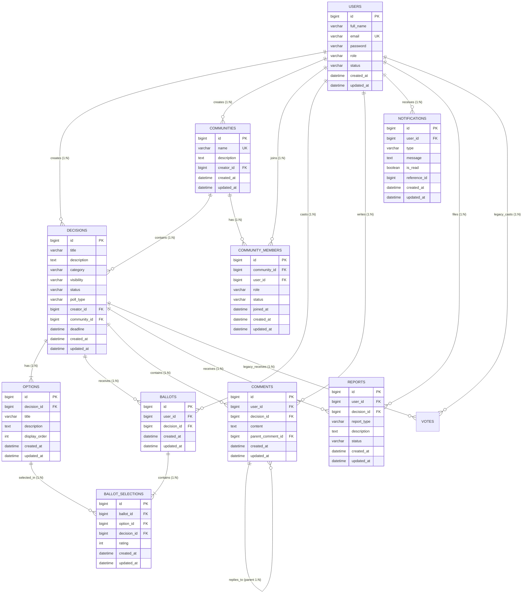
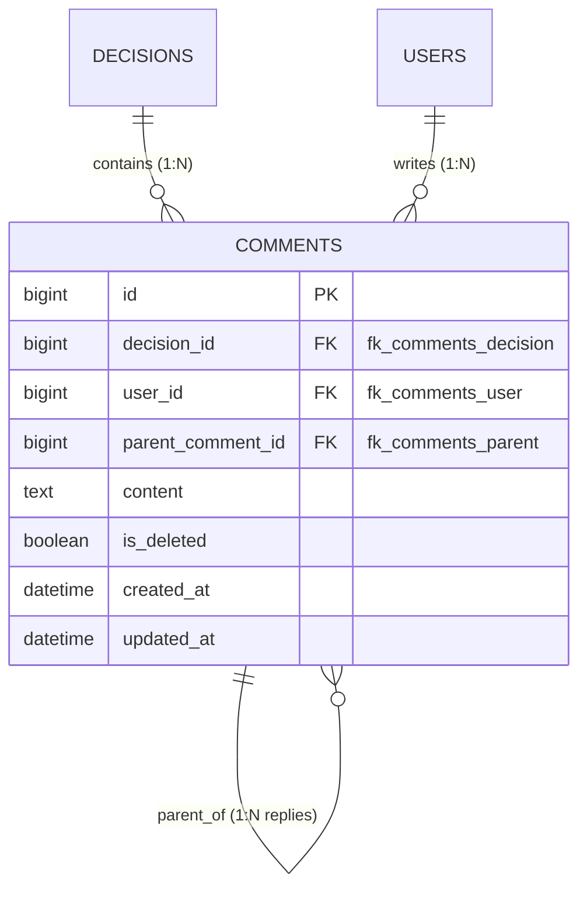
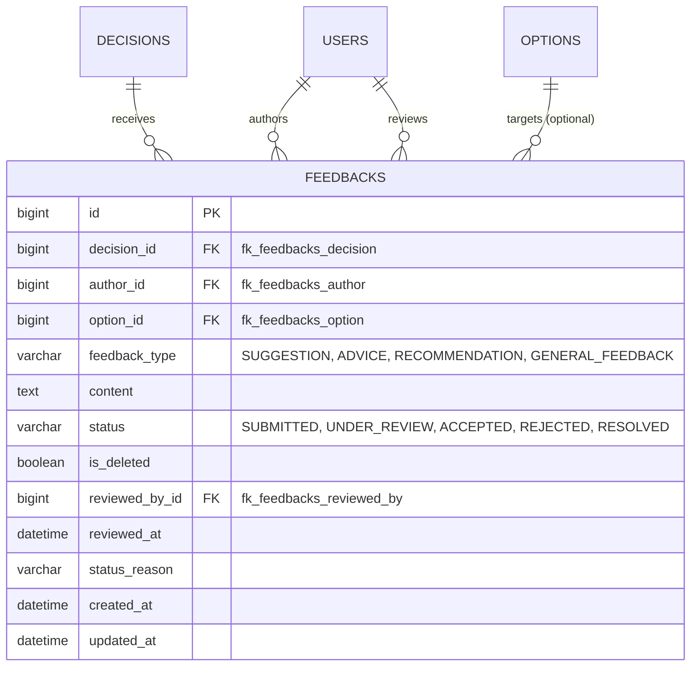
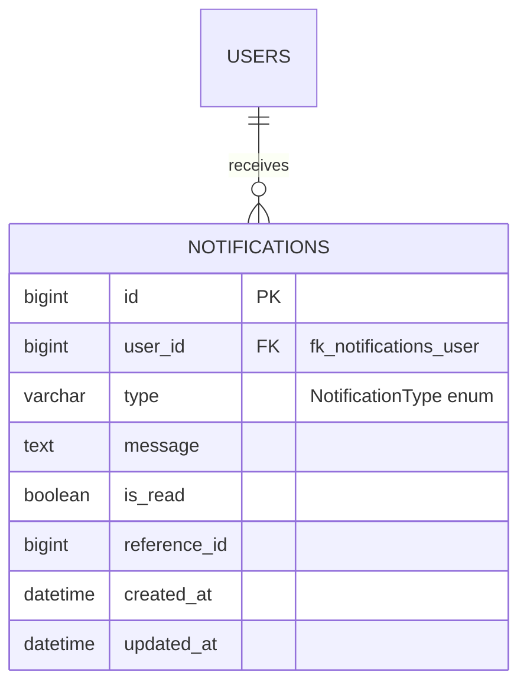

# DecisionHub – Backend

Collaborative Decision-Making & Community Polling Platform Backend Service.

DecisionHub is built with Java 21, Spring Boot 4.1.2, Spring Security, Spring Data JPA, and MySQL. It delivers secure, scalable RESTful APIs for decision management, polling, multi-option voting, community discussions, and notifications.

---

## 1. Database Architecture & Schema Design (Phase 2.1 Refined)

The DecisionHub database (`decisionhub`) follows a normalized relational structure (3NF) designed for high concurrency, relational integrity, multi-poll voting flexibility, and strict deduplication.

### Refined Entity Relationship Diagram (ERD)



---

## 2. Implemented Database Entities & Repositories

### 1. User (`users`)
- **Entity**: `User.java` | **Repository**: `UserRepository.java`
- **Columns**: `id`, `full_name`, `email` (UK), `password`, `role` (`ROLE_USER`, `ROLE_COMMUNITY_MODERATOR`, `ROLE_ADMIN`), `status` (`ACTIVE`, `PENDING`, `SUSPENDED`, `DEACTIVATED`), timestamps.

### 2. Community (`communities`)
- **Entity**: `Community.java` | **Repository**: `CommunityRepository.java`
- **Columns**: `id`, `name` (UK), `description`, `creator_id` (FK to `users.id`), timestamps.
- **Relationships**: Created by a User. Contains `decisions` and `members`.

### 3. Community Member (`community_members`)
- **Entity**: `CommunityMember.java` | **Repository**: `CommunityMemberRepository.java`
- **Columns**: `id`, `community_id` (FK), `user_id` (FK), `role` (`MEMBER`, `MODERATOR`, `ADMIN`), `status` (`ACTIVE`, `PENDING`, `BANNED`, `LEFT`), `joined_at`, timestamps.
- **Constraints**: `UNIQUE KEY uk_community_members_user_community (user_id, community_id)`. Prevents duplicate memberships at the database level.
- **Cascade Behavior**: Deleting a community cleans up membership associations without deleting user accounts.

### 4. Decision (`decisions`)
- **Entity**: `Decision.java` | **Repository**: `DecisionRepository.java`
- **Columns**: `id`, `title`, `description`, `category`, `visibility` (`PUBLIC`, `PRIVATE`), `status` (`DRAFT`, `ACTIVE`, `CLOSED`, `ARCHIVED`), `poll_type` (`SINGLE_CHOICE`, `MULTIPLE_CHOICE`, `RATING`), `creator_id` (FK), `community_id` (FK, nullable), `deadline`, timestamps.
- **Indexes**: `idx_decisions_creator`, `idx_decisions_community`, `idx_decisions_status`, `idx_decisions_category`.

### 5. Option (`options`)
- **Entity**: `Option.java` | **Repository**: `OptionRepository.java`
- **Columns**: `id`, `decision_id` (FK), `title`, `description`, `display_order`, timestamps.
- **Composite Key**: `UNIQUE KEY uk_options_id_decision (id, decision_id)`. Required for composite foreign key validation.

### 6. Ballot (`ballots`)
- **Entity**: `Ballot.java` | **Repository**: `BallotRepository.java`
- **Columns**: `id`, `user_id` (FK), `decision_id` (FK), timestamps.
- **Constraints**: `UNIQUE KEY uk_ballots_user_decision (user_id, decision_id)` and `UNIQUE KEY uk_ballots_id_decision (id, decision_id)`.
- **Purpose**: Establishes the user's ballot submission for a decision. Guarantees one ballot per user per decision.

### 7. Ballot Selection (`ballot_selections`)
- **Entity**: `BallotSelection.java` | **Repository**: `BallotSelectionRepository.java`
- **Columns**: `id`, `ballot_id` (FK), `option_id` (FK), `decision_id` (FK), `rating` (INT, nullable), timestamps.
- **Constraints**: `UNIQUE KEY uk_ballot_selections_ballot_option (ballot_id, option_id)`.
- **Composite Foreign Keys**:
  - `fk_ballot_selections_opt_dec`: `FOREIGN KEY (option_id, decision_id) REFERENCES options (id, decision_id)`
  - `fk_ballot_selections_bal_dec`: `FOREIGN KEY (ballot_id, decision_id) REFERENCES ballots (id, decision_id)`
- **Voting Mechanism Support**:
  - **Single-Choice**: Exactly 1 `BallotSelection` per `Ballot` (enforced at service level).
  - **Multiple-Choice**: Multiple `BallotSelection` rows per `Ballot` (preventing duplicates via `uk_ballot_selections_ballot_option`).
  - **Rating-Based**: Each selection carries a numeric score in `rating`.

### 8. Comment (`comments`)
- **Entity**: `Comment.java` | **Repository**: `CommentRepository.java`
- **Columns**: `id`, `user_id` (FK), `decision_id` (FK), `content`, `parent_comment_id` (FK, nullable), timestamps.
- **Composite Integrity Constraint**:
  - `UNIQUE KEY uk_comments_id_decision (id, decision_id)`
  - `CONSTRAINT fk_comments_parent_composite FOREIGN KEY (parent_comment_id, decision_id) REFERENCES comments (id, decision_id) ON DELETE CASCADE`
  - Guarantees that threaded replies cannot reference a parent comment from a different decision.

### 9. Notification (`notifications`)
- **Entity**: `Notification.java` | **Repository**: `NotificationRepository.java`
- **Columns**: `id`, `user_id` (FK), `type` (`VOTE_RECEIVED`, `DECISION_CLOSED`, `COMMENT_REPLY`, `SYSTEM`), `message`, `is_read`, `reference_id`, timestamps.

### 10. Report (`reports`)
- **Entity**: `Report.java` | **Repository**: `ReportRepository.java`
- **Columns**: `id`, `user_id` (FK), `decision_id` (FK), `report_type` (`SPAM`, `INAPPROPRIATE`, `MISINFORMATION`, `OTHER`), `description`, `status` (`PENDING`, `REVIEWED`, `DISMISSED`, `RESOLVED`), timestamps.

### 11. Legacy Vote Table (`votes`)
- Preserved for backwards compatibility with legacy phase data.
- Controlled migration plan documented below to transfer historical votes into `ballots` and `ballot_selections`.

---

## 3. Relational Integrity & Cross-Entity Consistency

| Integrity Boundary | Level of Enforcement | How It Is Enforced |
| :--- | :--- | :--- |
| **Duplicate Community Membership** | Database Engine | `UNIQUE (user_id, community_id)` in `community_members`. |
| **One Ballot Per User Per Decision** | Database Engine | `UNIQUE (user_id, decision_id)` in `ballots`. |
| **Duplicate Option on Same Ballot** | Database Engine | `UNIQUE (ballot_id, option_id)` in `ballot_selections`. |
| **Cross-Decision Option Selection** | Database Engine | Composite Foreign Key `(option_id, decision_id) REFERENCES options(id, decision_id)` in `ballot_selections`. |
| **Cross-Decision Comment Reply** | Database Engine | Composite Foreign Key `(parent_comment_id, decision_id) REFERENCES comments(id, decision_id)` in `comments`. |
| **Single-Choice / Max-Choice Quotas** | Service Level (Phase 4) | Validated in `VotingService` against `decision.pollType` and `maxChoicesAllowed`. |
| **Rating Score Boundaries (e.g., 1-5)** | Service Level (Phase 4) | Validated in `VotingService` and Jakarta Validation annotations. |

---

## 4. Database Migration Plan for Legacy Votes

To migrate historical records from the initial `votes` table into normalized `ballots` and `ballot_selections`:

```sql
-- Step 1: Migrate unique ballots from votes into ballots
INSERT INTO ballots (user_id, decision_id, created_at, updated_at)
SELECT v.user_id, v.decision_id, MIN(v.created_at), MIN(v.updated_at)
FROM votes v
GROUP BY v.user_id, v.decision_id;

-- Step 2: Migrate selections into ballot_selections matching the created ballot
INSERT INTO ballot_selections (ballot_id, option_id, decision_id, rating, created_at, updated_at)
SELECT b.id, v.option_id, v.decision_id, NULL, v.created_at, v.updated_at
FROM votes v
JOIN ballots b ON b.user_id = v.user_id AND b.decision_id = v.decision_id;

-- Step 3: Archive or deprecate the legacy votes table after verification
-- (DROP TABLE votes; executed only after verifying migration counts)
```

---

## 5. MySQL Installation & Environment Setup

1. **Verify Connectivity**:
   ```powershell
   Test-NetConnection -ComputerName localhost -Port 3306
   ```
2. **Environment Variables**:
   ```powershell
   $env:DB_USERNAME="root"
   $env:DB_PASSWORD="your_mysql_password"
   $env:DB_URL="jdbc:mysql://localhost:3306/decisionhub?createDatabaseIfNotExist=true&useSSL=false&allowPublicKeyRetrieval=true&serverTimezone=UTC"
   ```

---

## 6. Running Tests & Package Build

To run the entire 24-test suite:
```powershell
cd backend
.\mvnw.cmd test
```

To build the executable production JAR:
```powershell
cd backend
.\mvnw.cmd package
```
Output artifact: `target/backend-0.0.1-SNAPSHOT.jar`

---

## 7. Discussion Management (Milestone 3 - Phase 1)

DecisionHub provides threaded discussion threads, replies, and community moderation for decisions.

### 1. Discussion & Comment Entity Model



- **Threaded Hierarchies**: Top-level comments have `parent_comment_id = NULL`. Replies point to their parent `Comment`.
- **Soft Deletion Policy**: When a comment is deleted, `is_deleted = true` and `content = "[This comment has been deleted]"`. Child replies remain intact and linked in the thread.

---

### 2. Discussion Permissions & Access Control

| Action | Comment Author | Community Moderator | Global Admin (`ROLE_ADMIN`) | Non-Member / Other User |
|---|:---:|:---:|:---:|:---:|
| **Create Comment / Reply** | Yes | Yes | Yes | If decision is public or active community member |
| **View Comments** | Yes | Yes | Yes | Public or authorized member |
| **Edit Comment** | **Yes** | No | No | No |
| **Delete / Moderate Comment** | **Yes** | **Yes (in community)** | **Yes (globally)** | No |

---

### 3. API Reference Catalog

Base Path: `/api/v1`

| HTTP Method | Path | Auth Required | Description |
|---|---|:---:|---|
| `POST` | `/api/v1/decisions/{decisionId}/comments` | Yes | Create top-level comment on a decision |
| `GET` | `/api/v1/decisions/{decisionId}/comments` | Optional* | Retrieve paginated top-level comments |
| `PUT` | `/api/v1/comments/{commentId}` | Yes | Edit own comment (author only) |
| `DELETE` | `/api/v1/comments/{commentId}` | Yes | Delete comment (author, community moderator, admin) |
| `POST` | `/api/v1/comments/{commentId}/replies` | Yes | Create threaded reply to a comment |
| `GET` | `/api/v1/comments/{commentId}/replies` | Optional* | Retrieve paginated replies for a parent comment |
| `GET` | `/api/v1/decisions/{decisionId}/discussions/summary` | Optional* | Retrieve discussion activity metrics |

*\*Public decisions allow public access; private decisions enforce authentication and access restrictions.*

---

### 4. Sample Payloads

#### Create / Update Comment Request
```json
{
  "content": "Kafka offers superior event persistence and partition scalability compared to traditional message brokers."
}
```

#### Comment Response DTO
```json
{
  "success": true,
  "message": "Comment created successfully",
  "data": {
    "id": 1,
    "decisionId": 10,
    "author": {
      "id": 1,
      "fullName": "Alice Johnson",
      "email": "alice@example.com"
    },
    "content": "Kafka offers superior event persistence and partition scalability compared to traditional message brokers.",
    "parentCommentId": null,
    "isDeleted": false,
    "replyCount": 0,
    "createdAt": "2026-11-24T17:25:00",
    "updatedAt": "2026-11-24T17:25:00"
  },
  "timestamp": "2026-11-24T17:25:00"
}
```

#### Discussion Summary Response DTO
```json
{
  "success": true,
  "message": "Discussion summary retrieved successfully",
  "data": {
    "decisionId": 10,
    "totalComments": 14,
    "totalTopLevelComments": 5,
    "totalReplies": 9,
    "lastActivityAt": "2026-11-24T17:25:30"
  },
  "timestamp": "2026-11-24T17:25:30"
}
```

---

## 8. Milestone 3, Phase 2: Feedback Management

DecisionHub provides structured feedback management attached to decision boards and specific options, offering actionable suggestions, advice, and recommendations with formal moderation and status lifecycles.

### 1. Data Model & Relationships



- **Feedback Types**:
  - `SUGGESTION`: Constructive proposals for improving the decision or an option.
  - `ADVICE`: Guidance or domain wisdom regarding decision execution.
  - `RECOMMENDATION`: Explicit recommendation endorsing or cautioning an option.
  - `GENERAL_FEEDBACK`: Broad feedback on the overall poll or discussion scope.
- **Feedback Lifecycle Statuses**:
  - `SUBMITTED`: Newly posted by a community member (default).
  - `UNDER_REVIEW`: Decision owner or moderator is evaluating the feedback.
  - `ACCEPTED`: Feedback or recommendation adopted into consideration.
  - `REJECTED`: Feedback evaluated and dismissed (with optional rationale).
  - `RESOLVED`: Action items resulting from feedback have been addressed.

---

### 2. Permissions & Access Policy

| Action | Feedback Author | Decision Owner | Community Moderator | Global Admin (`ROLE_ADMIN`) | Other Member / Public |
|---|:---:|:---:|:---:|:---:|:---:|
| **Submit Feedback** | Yes | Yes | Yes | Yes | If decision is public or member |
| **View Feedback** | Yes | Yes | Yes | Yes | If decision is public or member |
| **Edit Feedback Content** | **Yes** | No | No | No | No |
| **Delete Feedback** | **Yes** | **Yes** | **Yes** | **Yes** | No |
| **Update Status (Review)** | No* | **Yes** | **Yes** | **Yes** | No |

*\*Ordinary users cannot approve, reject, or change the status of their own or others' feedback unless they possess decision ownership, community moderation, or administrative authority.*

---

### 3. API Reference Catalog

Base Path: `/api/v1`

| HTTP Method | Path | Auth Required | Description |
|---|---|:---:|---|
| `POST` | `/api/v1/decisions/{decisionId}/feedback` | Yes | Submit structured feedback on a decision or option |
| `GET` | `/api/v1/decisions/{decisionId}/feedback` | Optional* | Retrieve paginated feedback with optional type filtering |
| `GET` | `/api/v1/feedback/{feedbackId}` | Optional* | Retrieve individual feedback details |
| `PUT` | `/api/v1/feedback/{feedbackId}` | Yes | Edit own feedback content or associated option (author only) |
| `DELETE` | `/api/v1/feedback/{feedbackId}` | Yes | Soft-delete feedback (author, decision owner, moderator, admin) |
| `PUT` | `/api/v1/feedback/{feedbackId}/status` | Yes | Change feedback lifecycle status with optional reviewer reason |
| `GET` | `/api/v1/decisions/{decisionId}/feedback/summary` | Optional* | Retrieve aggregated feedback metrics, status and type counts |

*\*Public decisions allow public access; private decisions enforce authentication and access restrictions.*

---

### 4. Sample Payloads

#### Submit Feedback Request
```json
{
  "feedbackType": "SUGGESTION",
  "content": "Consider setting up benchmark tests comparing throughput and latency under high partition loads.",
  "optionId": 2
}
```

#### Feedback Response DTO
```json
{
  "success": true,
  "message": "Feedback submitted successfully",
  "data": {
    "id": 1,
    "decisionId": 10,
    "author": {
      "id": 1,
      "fullName": "Alice Johnson",
      "email": "alice@example.com"
    },
    "option": {
      "id": 2,
      "title": "Apache Kafka"
    },
    "feedbackType": "SUGGESTION",
    "content": "Consider setting up benchmark tests comparing throughput and latency under high partition loads.",
    "status": "SUBMITTED",
    "reviewedBy": null,
    "reviewedAt": null,
    "statusReason": null,
    "isDeleted": false,
    "createdAt": "2026-11-24T17:50:00",
    "updatedAt": "2026-11-24T17:50:00"
  },
  "timestamp": "2026-11-24T17:50:00"
}
```

#### Update Feedback Status Request
```json
{
  "status": "ACCEPTED",
  "reason": "Approved: 3-node cluster architecture meets reliability criteria and budget."
}
```

#### Feedback Summary Response DTO
```json
{
  "success": true,
  "message": "Feedback summary retrieved successfully",
  "data": {
    "decisionId": 10,
    "totalFeedback": 8,
    "countsByType": {
      "SUGGESTION": 3,
      "ADVICE": 2,
      "RECOMMENDATION": 2,
      "GENERAL_FEEDBACK": 1
    },
    "countsByStatus": {
      "SUBMITTED": 3,
      "UNDER_REVIEW": 2,
      "ACCEPTED": 2,
      "REJECTED": 1,
      "RESOLVED": 0
    },
    "lastActivityAt": "2026-11-24T17:55:00"
  },
  "timestamp": "2026-11-24T17:55:00"
}
```

---

## 9. Milestone 3, Phase 3: Notification System

DecisionHub features a centralized, in-app notification engine delivering targeted, event-driven alerts across discussions, feedback workflows, voting activity, community membership, and deadline lifecycles.

### 1. Data Model & Architecture



- **Notification Fields**:
  - `user`: Recipient of the notification.
  - `type`: Enum categorizing the notification trigger.
  - `message`: User-friendly human readable notification text.
  - `isRead`: Boolean read flag (default `false`).
  - `referenceId`: Optional ID linking to the related decision, comment, or community.
  - `createdAt`: Timestamp when the notification was generated.

---

### 2. Supported Notification Event Types

| Category | Type | Trigger / Recipient |
|---|---|---|
| **Discussions** | `COMMENT_RECEIVED` | Someone comments on a user's decision (notifies decision creator). |
| | `COMMENT_REPLY` | Someone replies to a user's comment (notifies parent comment author). |
| **Feedback** | `FEEDBACK_RECEIVED` | Someone submits feedback on a user's decision (notifies decision creator). |
| | `FEEDBACK_STATUS_CHANGED` | Feedback status updated by reviewer (notifies feedback author). |
| **Voting** | `VOTE_RECEIVED` | Someone votes on a poll (notifies poll creator). |
| | `POLL_DEADLINE_APPROACHING` | Scheduled reminder when poll deadline is within 24 hours. |
| | `DECISION_CLOSED` | Poll voting period expired and decision auto-closed. |
| **Community** | `MEMBERSHIP_REQUESTED` | New user joins community (notifies community creator). |
| | `MEMBERSHIP_APPROVED` | User membership request approved. |
| | `MEMBERSHIP_REJECTED` | User membership request rejected. |
| | `MEMBER_REMOVED` | User removed from community. |
| | `COMMUNITY_OWNERSHIP_TRANSFERRED` | Community ownership reassigned. |
| **System** | `SYSTEM` | Platform-wide administrative or system broadcast. |

---

### 3. Permissions & Deduplication Rules

- **Strict Recipient Isolation**: Users can only view, mark as read, or delete notifications where `user_id == authenticatedUserId`. Accessing another user's notification returns `403 Forbidden`.
- **Self-Action Suppression**: The system suppresses notification generation when a user performs an action on their own resources (e.g. author commenting on their own decision).
- **Scheduled Reminder Deduplication**: The scheduler verifies via `existsByUserIdAndTypeAndReferenceId` before publishing deadline reminders, preventing duplicate alerts.

---

### 4. Scheduled Background Jobs

- **Class**: `DecisionDeadlineScheduler`
- **Execution Interval**: Fixed rate of 60 seconds (`fixedDelay = 60000`).
- **Behaviors**:
  1. **Approaching Deadlines**: Scans active decisions expiring within the next 24 hours. Emits `POLL_DEADLINE_APPROACHING` once per decision.
  2. **Auto-Close Expired Polls**: Scans active decisions where `deadline < now()`. Transitions status to `COMPLETED` and emits `DECISION_CLOSED` once.

---

### 5. API Reference Catalog

Base Path: `/api/v1/notifications`

| HTTP Method | Path | Auth Required | Description |
|---|---|:---:|---|
| `GET` | `/api/v1/notifications` | Yes | Retrieve paginated notifications for current user (newest first) |
| `GET` | `/api/v1/notifications/unread` | Yes | Retrieve only unread paginated notifications |
| `GET` | `/api/v1/notifications/unread/count` | Yes | Retrieve total count of unread notifications |
| `PUT` | `/api/v1/notifications/{notificationId}/read` | Yes | Mark a specific notification as read (recipient only) |
| `PUT` | `/api/v1/notifications/read-all` | Yes | Mark all notifications as read for current user |
| `DELETE` | `/api/v1/notifications/{notificationId}` | Yes | Delete a specific notification (recipient only) |

---

### 6. Sample Payloads

#### Notification Response DTO
```json
{
  "success": true,
  "message": "Notifications retrieved successfully",
  "data": {
    "content": [
      {
        "id": 1,
        "userId": 541,
        "type": "COMMENT_RECEIVED",
        "message": "Bob Miller commented on your decision: 'Adopt Event-Driven Architecture'",
        "isRead": false,
        "referenceId": 233,
        "createdAt": "2026-11-24T18:45:00"
      }
    ],
    "page": 0,
    "size": 10,
    "totalElements": 1,
    "totalPages": 1,
    "last": true
  },
  "timestamp": "2026-11-24T18:45:00"
}
```

#### Unread Count Response DTO
```json
{
  "success": true,
  "message": "Unread count retrieved successfully",
  "data": {
    "unreadCount": 3
  },
  "timestamp": "2026-11-24T18:45:05"
}
```


