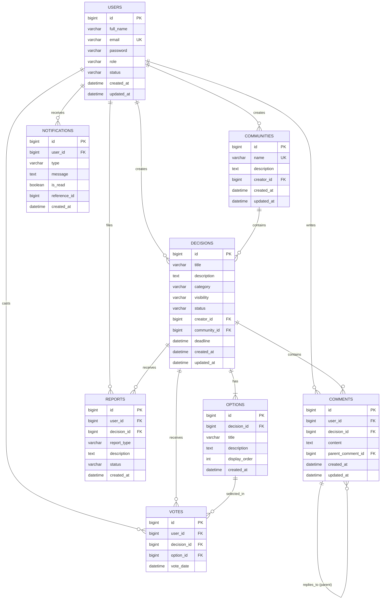

# DecisionHub – Backend

Collaborative Decision-Making & Community Polling Platform Backend Service.

DecisionHub is built with Spring Boot, Spring Security, Spring Data JPA, and MySQL. It delivers secure, scalable RESTful APIs for decision management, polling, multi-option voting, community discussions, and notifications.

---

## 1. Database Architecture & Schema Design

The DecisionHub database (`decisionhub`) follows a normalized relational structure designed for performance, relational integrity, and strict deduplication (such as preventing multiple votes per user on a decision).

### Entity Relationship Diagram (ERD)



---

## 2. Entity Details & Relational Rules

### Implemented in Phase 2:
1. **User (`users`)**:
   - `id`: BIGINT AUTO_INCREMENT Primary Key (inherited from `BaseEntity`).
   - `full_name`: VARCHAR(100), NOT NULL.
   - `email`: VARCHAR(100), NOT NULL, UNIQUE constraint (`uk_users_email`).
   - `password`: VARCHAR(255), NOT NULL (encrypted hash via BCrypt in auth phase).
   - `role`: VARCHAR(30), NOT NULL (`ROLE_USER`, `ROLE_COMMUNITY_MODERATOR`, `ROLE_ADMIN`).
   - `status`: VARCHAR(20), NOT NULL (`ACTIVE`, `PENDING`, `SUSPENDED`, `DEACTIVATED`).
   - `created_at` & `updated_at`: Standard auditing timestamps from `BaseEntity`.

### Designed for Upcoming Milestones:
2. **Community (`communities`)**:
   - Organization or interest group hosting collective decisions.
   - Foreign Key: `creator_id` -> `users(id)`.
3. **Decision (`decisions`)**:
   - Core poll or decision topic. Supports categories, visibility rules (`PUBLIC`, `PRIVATE`), and status (`DRAFT`, `ACTIVE`, `CLOSED`, `ARCHIVED`).
   - Foreign Keys: `creator_id` -> `users(id)`, `community_id` -> `communities(id)` (nullable).
4. **Option (`options`)**:
   - Choices available under a decision.
   - Foreign Key: `decision_id` -> `decisions(id)` ON DELETE CASCADE.
5. **Vote (`votes`)**:
   - Ballot cast by a user.
   - Foreign Keys: `user_id` -> `users(id)`, `decision_id` -> `decisions(id)`, `option_id` -> `options(id)`.
   - **Single-Choice Deduplication**: Unique constraint `(user_id, decision_id)` prevents ballot stuffing or multiple votes by the same user on a given decision.
6. **Comment (`comments`)**:
   - Discussions under decisions with support for threaded replies via self-referencing `parent_comment_id`.
   - Foreign Keys: `user_id` -> `users(id)`, `decision_id` -> `decisions(id)`, `parent_comment_id` -> `comments(id)`.
7. **Notification (`notifications`)**:
   - User notifications for poll closures, replies, and system alerts.
   - Foreign Key: `user_id` -> `users(id)` ON DELETE CASCADE.
8. **Report (`reports`)**:
   - Community moderation reports for objectionable content or spam.
   - Foreign Keys: `user_id` -> `users(id)`, `decision_id` -> `decisions(id)`.

---

## 3. Relational Integrity & Architectural Analysis

### A. Voting Constraint: Single-Choice vs Multiple-Choice
- **Current Constraint**: `UNIQUE KEY uk_votes_user_decision (user_id, decision_id)`
  - **Single-Choice Impact**: Enforces the one-person-one-vote rule at the database level. Attempting to cast a second ballot throws a MySQL error 1062 (`DataIntegrityViolationException`). If a user wishes to change their selection, the record is updated with the new `option_id`.
  - **Multiple-Choice Impact**: In polls where users may select multiple options, this constraint would prevent selecting a second option.
  - **Planned Architectural Evolution**: When multiple-choice polls are introduced in future milestones, the platform can either:
    1. Adopt a two-tier ballot schema (`ballots` table with `UNIQUE(user_id, decision_id)` and a child `ballot_options` table for multiple choices).
    2. Adjust the constraint to `UNIQUE(user_id, decision_id, option_id)` accompanied by an application-level constraint enforcing a `max_selections` quota defined on the decision.

### B. Cross-Entity Integrity Boundaries
- **Option & Decision Consistency**:
  - In `votes`, both `decision_id` and `option_id` are stored. A theoretical risk exists where a rogue request supplies `decision_id = 1` and `option_id = 42` (where option 42 belongs to decision 2).
  - *Mitigation*: The service layer validates `option.getDecision().getId().equals(decisionId)` prior to persistence.
- **Comment Parent & Decision Consistency**:
  - In `comments`, a reply references `parent_comment_id` and `decision_id`.
  - *Mitigation*: The service layer enforces that `parentComment.getDecision().getId().equals(decisionId)` before saving a threaded reply.

### C. Hibernate DDL Configuration & Migration Roadmap
- **Current Configuration**: `spring.jpa.hibernate.ddl-auto=update`
  - *Suitability*: Ideal for rapid local prototyping and early development milestones. Automatically generates newly added tables, columns, and foreign keys without dropping existing developer data.
  - *Limitations*: Does not drop obsolete columns, cannot automatically handle column renames, and cannot execute data migrations.
  - *Future Migration Strategy*: When approaching staging and production deployments, transition to a version-controlled database migration framework (**Flyway**). `ddl-auto` will be set to `validate` (or `none`), and all DDL changes will be tracked as versioned SQL migration scripts (`V1__init.sql`, `V2__add_decisions.sql`).

---

## 4. MySQL Installation & Setup

1. **Install MySQL Server** (Version 8.0 or higher):
   - Ensure the MySQL service is running on `localhost:3306`.
2. **Create the Database**:
   Connect via MySQL CLI, MySQL Workbench, or PowerShell:
   ```sql
   CREATE DATABASE IF NOT EXISTS decisionhub
     CHARACTER SET utf8mb4
     COLLATE utf8mb4_unicode_ci;
   ```
3. **Verify Database Connectivity**:
   ```powershell
   Test-NetConnection -ComputerName localhost -Port 3306
   ```

---

## 5. Environment Variable Configuration

`src/main/resources/application.properties` **strictly requires** database credentials to be supplied via environment variables. There are **no hardcoded fallback credentials** (`root/root`) in the runtime configuration.

### Environment Variables

| Variable Name | Required? | Description | Example Value |
| :--- | :--- | :--- | :--- |
| `DB_USERNAME` | **Yes (Required)** | MySQL Database Username | `root` |
| `DB_PASSWORD` | **Yes (Required)** | MySQL Database Password | `your_mysql_password` |
| `DB_URL` | Optional | JDBC Connection String | `jdbc:mysql://localhost:3306/decisionhub?createDatabaseIfNotExist=true&useSSL=false&allowPublicKeyRetrieval=true&serverTimezone=UTC` |
| `CORS_ALLOWED_ORIGINS` | Optional | Comma-separated allowed frontend origins | `http://localhost:3000,http://localhost:5173` |

### Setting Environment Variables in Windows PowerShell

To set environment variables for the current PowerShell session:
```powershell
$env:DB_USERNAME="root"
$env:DB_PASSWORD="your_mysql_password"
$env:DB_URL="jdbc:mysql://localhost:3306/decisionhub?createDatabaseIfNotExist=true&useSSL=false&allowPublicKeyRetrieval=true&serverTimezone=UTC"
$env:CORS_ALLOWED_ORIGINS="http://localhost:3000,http://localhost:5173"
```

To set persistent User environment variables in Windows (survives reboots):
```powershell
[System.Environment]::SetEnvironmentVariable('DB_USERNAME', 'root', 'User')
[System.Environment]::SetEnvironmentVariable('DB_PASSWORD', 'your_mysql_password', 'User')
```

---

## 6. Running the Application

Ensure Java 21, MySQL, and the required environment variables are set, then start the application using the Maven wrapper:

```powershell
cd backend
$env:DB_USERNAME="root"
$env:DB_PASSWORD="your_mysql_password"
.\mvnw.cmd spring-boot:run
```

The application starts on port `8080` by default. Verify the health check endpoint:
```
GET http://localhost:8080/api/v1/health
```

---

## 7. Running Tests

To compile and execute the complete test suite (application context, health controllers, and transactional database persistence tests against MySQL):

```powershell
cd backend
.\mvnw.cmd test
```

To package the executable production JAR:

```powershell
cd backend
.\mvnw.cmd package -DskipTests
```
Output artifact: `target/backend-0.0.1-SNAPSHOT.jar`
