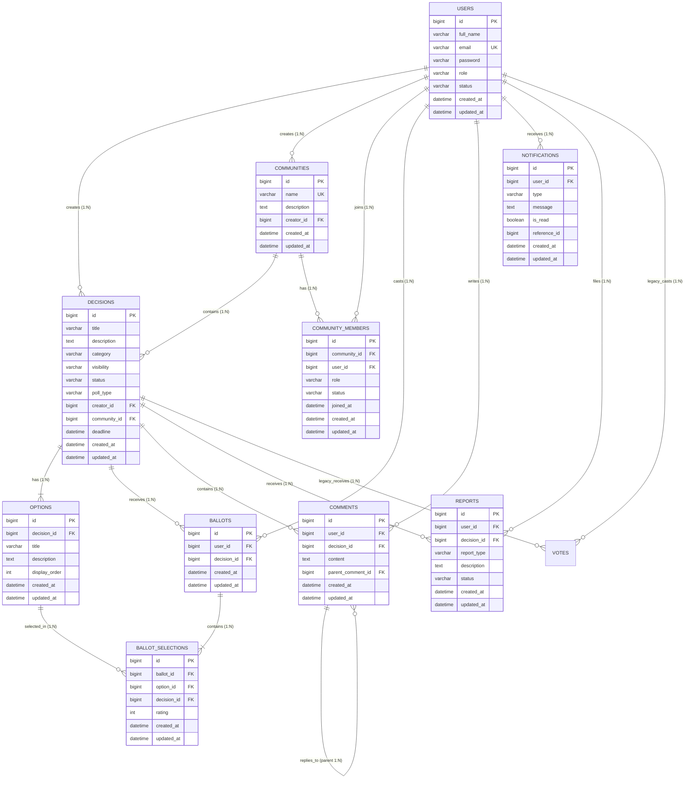

# DecisionHub – Backend

Collaborative Decision-Making & Community Polling Platform Backend Service.

DecisionHub is built with Java 21, Spring Boot 4.1.2, Spring Security, Spring Data JPA, and MySQL. It delivers secure, scalable RESTful APIs for decision management, polling, multi-option voting, community discussions, and notifications.

---

## 1. Database Architecture & Schema Design (Phase 2.1 Refined)

The DecisionHub database (`decisionhub`) follows a normalized relational structure (3NF) designed for high concurrency, relational integrity, multi-poll voting flexibility, and strict deduplication.

### Refined Entity Relationship Diagram (ERD)



---

## 2. Implemented Database Entities & Repositories

### 1. User (`users`)
- **Entity**: `User.java` | **Repository**: `UserRepository.java`
- **Columns**: `id`, `full_name`, `email` (UK), `password`, `role` (`ROLE_USER`, `ROLE_COMMUNITY_MODERATOR`, `ROLE_ADMIN`), `status` (`ACTIVE`, `PENDING`, `SUSPENDED`, `DEACTIVATED`), timestamps.

### 2. Community (`communities`)
- **Entity**: `Community.java` | **Repository**: `CommunityRepository.java`
- **Columns**: `id`, `name` (UK), `description`, `creator_id` (FK to `users.id`), timestamps.
- **Relationships**: Created by a User. Contains `decisions` and `members`.

### 3. Community Member (`community_members`)
- **Entity**: `CommunityMember.java` | **Repository**: `CommunityMemberRepository.java`
- **Columns**: `id`, `community_id` (FK), `user_id` (FK), `role` (`MEMBER`, `MODERATOR`, `ADMIN`), `status` (`ACTIVE`, `PENDING`, `BANNED`, `LEFT`), `joined_at`, timestamps.
- **Constraints**: `UNIQUE KEY uk_community_members_user_community (user_id, community_id)`. Prevents duplicate memberships at the database level.
- **Cascade Behavior**: Deleting a community cleans up membership associations without deleting user accounts.

### 4. Decision (`decisions`)
- **Entity**: `Decision.java` | **Repository**: `DecisionRepository.java`
- **Columns**: `id`, `title`, `description`, `category`, `visibility` (`PUBLIC`, `PRIVATE`), `status` (`DRAFT`, `ACTIVE`, `CLOSED`, `ARCHIVED`), `poll_type` (`SINGLE_CHOICE`, `MULTIPLE_CHOICE`, `RATING`), `creator_id` (FK), `community_id` (FK, nullable), `deadline`, timestamps.
- **Indexes**: `idx_decisions_creator`, `idx_decisions_community`, `idx_decisions_status`, `idx_decisions_category`.

### 5. Option (`options`)
- **Entity**: `Option.java` | **Repository**: `OptionRepository.java`
- **Columns**: `id`, `decision_id` (FK), `title`, `description`, `display_order`, timestamps.
- **Composite Key**: `UNIQUE KEY uk_options_id_decision (id, decision_id)`. Required for composite foreign key validation.

### 6. Ballot (`ballots`)
- **Entity**: `Ballot.java` | **Repository**: `BallotRepository.java`
- **Columns**: `id`, `user_id` (FK), `decision_id` (FK), timestamps.
- **Constraints**: `UNIQUE KEY uk_ballots_user_decision (user_id, decision_id)` and `UNIQUE KEY uk_ballots_id_decision (id, decision_id)`.
- **Purpose**: Establishes the user's ballot submission for a decision. Guarantees one ballot per user per decision.

### 7. Ballot Selection (`ballot_selections`)
- **Entity**: `BallotSelection.java` | **Repository**: `BallotSelectionRepository.java`
- **Columns**: `id`, `ballot_id` (FK), `option_id` (FK), `decision_id` (FK), `rating` (INT, nullable), timestamps.
- **Constraints**: `UNIQUE KEY uk_ballot_selections_ballot_option (ballot_id, option_id)`.
- **Composite Foreign Keys**:
  - `fk_ballot_selections_opt_dec`: `FOREIGN KEY (option_id, decision_id) REFERENCES options (id, decision_id)`
  - `fk_ballot_selections_bal_dec`: `FOREIGN KEY (ballot_id, decision_id) REFERENCES ballots (id, decision_id)`
- **Voting Mechanism Support**:
  - **Single-Choice**: Exactly 1 `BallotSelection` per `Ballot` (enforced at service level).
  - **Multiple-Choice**: Multiple `BallotSelection` rows per `Ballot` (preventing duplicates via `uk_ballot_selections_ballot_option`).
  - **Rating-Based**: Each selection carries a numeric score in `rating`.

### 8. Comment (`comments`)
- **Entity**: `Comment.java` | **Repository**: `CommentRepository.java`
- **Columns**: `id`, `user_id` (FK), `decision_id` (FK), `content`, `parent_comment_id` (FK, nullable), timestamps.
- **Composite Integrity Constraint**:
  - `UNIQUE KEY uk_comments_id_decision (id, decision_id)`
  - `CONSTRAINT fk_comments_parent_composite FOREIGN KEY (parent_comment_id, decision_id) REFERENCES comments (id, decision_id) ON DELETE CASCADE`
  - Guarantees that threaded replies cannot reference a parent comment from a different decision.

### 9. Notification (`notifications`)
- **Entity**: `Notification.java` | **Repository**: `NotificationRepository.java`
- **Columns**: `id`, `user_id` (FK), `type` (`VOTE_RECEIVED`, `DECISION_CLOSED`, `COMMENT_REPLY`, `SYSTEM`), `message`, `is_read`, `reference_id`, timestamps.

### 10. Report (`reports`)
- **Entity**: `Report.java` | **Repository**: `ReportRepository.java`
- **Columns**: `id`, `user_id` (FK), `decision_id` (FK), `report_type` (`SPAM`, `INAPPROPRIATE`, `MISINFORMATION`, `OTHER`), `description`, `status` (`PENDING`, `REVIEWED`, `DISMISSED`, `RESOLVED`), timestamps.

### 11. Legacy Vote Table (`votes`)
- Preserved for backwards compatibility with legacy phase data.
- Controlled migration plan documented below to transfer historical votes into `ballots` and `ballot_selections`.

---

## 3. Relational Integrity & Cross-Entity Consistency

| Integrity Boundary | Level of Enforcement | How It Is Enforced |
| :--- | :--- | :--- |
| **Duplicate Community Membership** | Database Engine | `UNIQUE (user_id, community_id)` in `community_members`. |
| **One Ballot Per User Per Decision** | Database Engine | `UNIQUE (user_id, decision_id)` in `ballots`. |
| **Duplicate Option on Same Ballot** | Database Engine | `UNIQUE (ballot_id, option_id)` in `ballot_selections`. |
| **Cross-Decision Option Selection** | Database Engine | Composite Foreign Key `(option_id, decision_id) REFERENCES options(id, decision_id)` in `ballot_selections`. |
| **Cross-Decision Comment Reply** | Database Engine | Composite Foreign Key `(parent_comment_id, decision_id) REFERENCES comments(id, decision_id)` in `comments`. |
| **Single-Choice / Max-Choice Quotas** | Service Level (Phase 4) | Validated in `VotingService` against `decision.pollType` and `maxChoicesAllowed`. |
| **Rating Score Boundaries (e.g., 1-5)** | Service Level (Phase 4) | Validated in `VotingService` and Jakarta Validation annotations. |

---

## 4. Database Migration Plan for Legacy Votes

To migrate historical records from the initial `votes` table into normalized `ballots` and `ballot_selections`:

```sql
-- Step 1: Migrate unique ballots from votes into ballots
INSERT INTO ballots (user_id, decision_id, created_at, updated_at)
SELECT v.user_id, v.decision_id, MIN(v.created_at), MIN(v.updated_at)
FROM votes v
GROUP BY v.user_id, v.decision_id;

-- Step 2: Migrate selections into ballot_selections matching the created ballot
INSERT INTO ballot_selections (ballot_id, option_id, decision_id, rating, created_at, updated_at)
SELECT b.id, v.option_id, v.decision_id, NULL, v.created_at, v.updated_at
FROM votes v
JOIN ballots b ON b.user_id = v.user_id AND b.decision_id = v.decision_id;

-- Step 3: Archive or deprecate the legacy votes table after verification
-- (DROP TABLE votes; executed only after verifying migration counts)
```

---

## 5. MySQL Installation & Environment Setup

1. **Verify Connectivity**:
   ```powershell
   Test-NetConnection -ComputerName localhost -Port 3306
   ```
2. **Environment Variables**:
   ```powershell
   $env:DB_USERNAME="root"
   $env:DB_PASSWORD="your_mysql_password"
   $env:DB_URL="jdbc:mysql://localhost:3306/decisionhub?createDatabaseIfNotExist=true&useSSL=false&allowPublicKeyRetrieval=true&serverTimezone=UTC"
   ```

---

## 6. Running Tests & Package Build

To run the entire 24-test suite:
```powershell
cd backend
.\mvnw.cmd test
```

To build the executable production JAR:
```powershell
cd backend
.\mvnw.cmd package
```
Output artifact: `target/backend-0.0.1-SNAPSHOT.jar`
